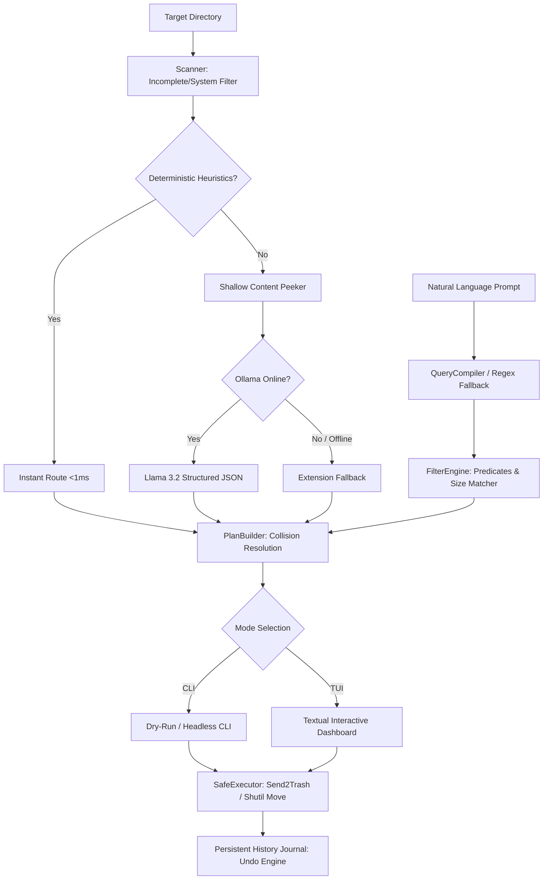

# Local LLM File Organiser

[](https://www.python.org/downloads/)
[](https://opensource.org/licenses/MIT)
[]()
[]()
[](https://github.com/astral-sh/ruff)

An intelligent, local file organiser powered by deterministic heuristics and local Llama 3.2 via Ollama, featuring an interactive full-screen Textual TUI, natural language query actions, and atomic undo support.



## Features

- **Hybrid Pipeline**:
  - **Deterministic Heuristics**: Instantly sorts common files (installers, archives, fonts, disk images) in sub-millisecond time with zero LLM overhead.
  - **Shallow Content Peeker**: Safely extracts the first few kilobytes or text snippets from PDFs, code, and documents for contextual understanding.
  - **Local LLM Classification**: Uses local Ollama (`llama3.2` by default) with structured JSON schemas to infer semantic folders and subfolders.
  - **Offline / Graceful Fallback**: Automatically falls back to extension-based rules if Ollama is offline or when running with `--no-llm`.
- **Natural Language Query Engine**:
  - Compiles free-form English prompts into typed predicate ASTs (actions: `FIND`, `MOVE`, `TRASH`).
  - Supports compound extensions, file size filters (`>50MB`, `<10KB`), and age thresholds.
  - Interactive (`-i`) flag to inspect and modify query matches directly inside the TUI.
- **Safety First**:
  - **Collision Resolution**: Automatic `(1)`, `(2)` incrementing preserves existing files without unintended overwrites.
  - **Recycle Bin Integration**: Safe deletions route through OS trash (`send2trash`) instead of permanent unrecoverable deletion.
  - **Undo Journal**: Every move and trash operation is recorded in a persistent journal (`~/.file_organizer/history.json`), allowing instant reversion via `file-organizer undo`.
- **Interactive TUI**:
  - Full-screen dashboard built with [Textual](https://textual.textualize.io/).
  - Keyboard shortcuts to toggle items (`Space`, `a`), customize destination paths (`e`), cycle collision strategies (`c`), and search/filter (`/`).
  - Pre-execution confirmation modal displaying exact action counts.
  - Content preview box highlighting snippets of selected files.

## Installation

Ensure Python 3.10+ is installed.

```bash
git clone https://github.com/CalebWu1/file-manager.git
cd file-manager
pip install -e ".[dev]"
```

To run with local AI classification, ensure [Ollama](https://ollama.com/) is installed and running:

```bash
ollama run llama3.2
```

## Usage

*Note: Both `file-organizer` and `file-organiser` CLI commands are available.*

### 1. Interactive TUI Mode

Organise a target directory (defaults to `~/Downloads` if omitted):

```bash
file-organizer ~/Downloads
# Or with Commonwealth spelling:
file-organiser ~/Downloads
```

### 2. Natural Language Querying & Actions

Search, batch move, or clean files using plain English:

```bash
# Preview finding all invoices in dry-run mode
file-organizer query --dry-run "find all invoices"

# Move archives and installers larger than 50MB into an Archive directory
file-organizer query "move all zip files and installers over 50MB to Archive"

# Safely trash temporary files
file-organizer query "trash all .tmp and .bak files"

# Open query results interactively in the TUI
file-organizer query -i "find all python scripts"
```

### 3. Dry-Run Mode

Preview planned move operations directly in stdout without opening the TUI or modifying files:

```bash
file-organizer ~/Downloads --dry-run
```

### 4. Pure Heuristic Mode (Offline / No LLM)

Run strictly with deterministic rules and heuristic fallbacks without querying Ollama:

```bash
file-organizer ~/Downloads --dry-run --no-llm
```

### 5. Custom LLM Model

Specify an alternative local Ollama model:

```bash
file-organizer ~/Downloads --model llama3.1:8b
```

### 6. Undo Previous Sessions

Revert operations from the most recent session or specify a specific session ID:

```bash
# Undo the most recent session
file-organizer undo

# Undo a specific session by ID
file-organizer undo --session-id <session_id>
```

## Keyboard Shortcuts (TUI)

| Key | Action |
| --- | --- |
| `/` | Open natural language query / filter modal |
| `Esc` | Clear query filter / close modal |
| `Space` | Toggle include/skip for selected row |
| `a` | Toggle include/skip for all rows |
| `e` | Edit destination folder for selected file |
| `c` | Cycle collision action (AutoRename -> Overwrite -> Skip) |
| `x` | Open confirmation modal & execute moves |
| `q` | Quit without executing |

## Testing

Run the full automated test suite using `pytest`:

```bash
# Run 164 unit and integration tests
pytest tests/ -v

# Run tests with code coverage report
pytest --cov=file_organizer --cov-report=term-missing
```

## License

This project is licensed under the MIT License — see the [LICENSE](LICENSE) file for details.
