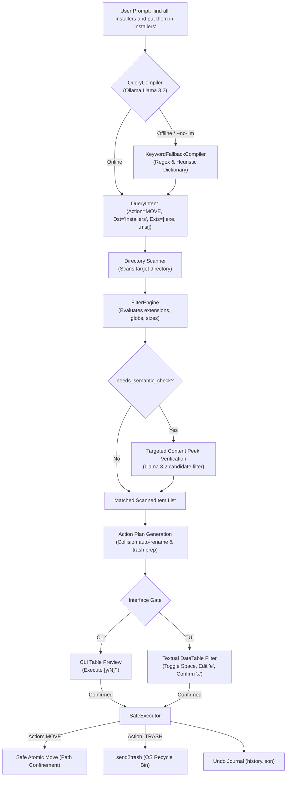

# Spec: Natural Language File Query & Action Subsystem

## 1. Overview & Goals

The `folder-organizer` application currently organizes files by classifying them into standardized subfolders based on file metadata and local LLM content classification.

This specification defines the **Natural Language File Query & Action Subsystem**, enabling users to:
1. Search and filter files within a target directory using natural language queries (e.g., *"find all installers"*, *"invoices from 2024"*, *"videos over 500MB"*).
2. Execute targeted batch operations directly from query intent (e.g., *"move all installers into an Installers folder"*, *"delete all temporary downloads"*).
3. Safely delete files by recycling them via the native OS Recycle Bin / Trash (`send2trash`) with persistent undo journal logging, ensuring zero unrecoverable data loss.
4. Access this capability both via a standalone CLI command (`folder-organizer query`) and an interactive in-TUI search bar triggered by pressing `/` in the Textual dashboard.
5. Provide a deterministic offline fallback (`--no-llm` / unreachable Ollama) that interprets common keyword concepts, wildcards, and file size expressions without network or inference dependencies.

---

## 2. Architecture & System Flow

The subsystem uses a **Two-Tier Hybrid Architecture**:
- **Tier 1 (Query Compiler & Instant Filtering):** Translates the natural language prompt into a structured query specification (`QueryIntent`), extracting the intended action (`FIND`, `MOVE`, `TRASH`), destination folder, and metadata filters (`extensions`, `name_patterns`, `min_size_bytes`, `max_size_bytes`, `date bounds`). A local Python evaluation instantly matches files against these filters in memory.
- **Tier 2 (Targeted Semantic Verification):** If the query involves semantic content inspection (e.g. *"receipts from Amazon"*, *"contracts"*), only the candidates matching metadata filters are passed to local Llama 3.2 with their shallow content peeks (from `file_peek.py`) to verify semantic matches.



---

## 3. Data Models (`folder_organizer/models.py`)

New data models and extensions added to `folder_organizer/models.py`:

```python
from datetime import datetime
from enum import Enum
from pathlib import Path
from typing import Optional
from pydantic import BaseModel, Field


class ActionType(str, Enum):
    FIND = "FIND"  # Pure search / display matches
    MOVE = "MOVE"  # Move matches to target directory
    TRASH = "TRASH"  # Safely send matches to system Recycle Bin


class QueryPredicates(BaseModel):
    extensions: list[str] = Field(default_factory=list)
    name_patterns: list[str] = Field(default_factory=list)
    min_size_bytes: Optional[int] = None
    max_size_bytes: Optional[int] = None
    modified_after: Optional[datetime] = None
    modified_before: Optional[datetime] = None
    needs_semantic_check: bool = False
    semantic_prompt: Optional[str] = None


class QueryIntent(BaseModel):
    raw_query: str
    action: ActionType
    destination_folder: Optional[str] = None
    predicates: QueryPredicates = Field(default_factory=QueryPredicates)
    reasoning: str = ""


class ActionOperation(BaseModel):
    source_path: Path
    action: ActionType
    target_path: Optional[Path] = None
    intended_path: Optional[Path] = None
    collision_action: CollisionAction = CollisionAction.AUTO_RENAME
    collision_detected: bool = False
    selected: bool = True
    match_reason: str = ""


class JournalEntry(BaseModel):
    action: ActionType = ActionType.MOVE
    source: Path
    destination: Optional[Path] = None
    timestamp: datetime = Field(default_factory=datetime.now)


class HistorySession(BaseModel):
    session_id: str
    timestamp: datetime
    target_dir: Path
    query_prompt: Optional[str] = None
    operations: list[JournalEntry]
```

---

## 4. Query Compiler & Keyword Fallback (`folder_organizer/query/compiler.py`)

The query compiler interprets natural language into structured `QueryIntent`.

### 4.1 LLM Structured Compilation (`QueryCompiler`)
Uses the official `ollama` Python client targeting `llama3.2` with structured JSON schema:
- **System Prompt:** Instructs Llama 3.2 to parse user search terms, action intent, destination folder names, and predicate filters.
- **Rules:**
  - If user mentions *"delete"*, *"trash"*, *"clean up"*, or *"remove"*, `action` = `ActionType.TRASH`.
  - If user mentions *"move to <folder>"*, *"put in <folder>"*, or *"organize into <folder>"*, `action` = `ActionType.MOVE`, `destination_folder` = `<folder>`.
  - Otherwise, `action` = `ActionType.FIND`.
  - Common concept expansion: Maps *"installers"* to `[".exe", ".msi", ".dmg", ".pkg", ".deb", ".rpm", ".appinstaller"]`.
  - Sets `needs_semantic_check = true` only when file extension/name alone cannot definitively satisfy the query (e.g. *"bank statements"*, *"receipts"*).

### 4.2 Heuristic Fallback (`KeywordFallbackCompiler`)
When Ollama is unreachable or `--no-llm` is active:
- **Action Regex:**
  - `(delete|trash|remove)\s+(.*)` $\rightarrow$ `ActionType.TRASH`
  - `(move|put|store)\s+(?:all\s+)?(.*?)\s+(?:in|to|into)\s+([a-zA-Z0-9_\- ]+)` $\rightarrow$ `ActionType.MOVE`, `destination_folder` = captured group
  - Otherwise $\rightarrow$ `ActionType.FIND`
- **Keyword Dictionary:**
  - `installer`, `setup`, `installation` $\rightarrow$ `[".exe", ".msi", ".dmg", ".pkg", ".appinstaller", ".deb", ".rpm"]`
  - `archive`, `zip`, `compressed` $\rightarrow$ `[".zip", ".tar.gz", ".tar.bz2", ".tar.xz", ".7z", ".rar"]`
  - `video`, `movie` $\rightarrow$ `[".mp4", ".mkv", ".mov", ".avi", ".webm"]`
  - `audio`, `music`, `song` $\rightarrow$ `[".mp3", ".wav", ".flac", ".m4a", ".aac"]`
  - `image`, `photo`, `picture` $\rightarrow$ `[".png", ".jpg", ".jpeg", ".gif", ".webp", ".svg"]`
  - `document`, `doc` $\rightarrow$ `[".pdf", ".docx", ".doc", ".txt", ".xlsx", ".csv", ".pptx"]`
  - `code`, `script` $\rightarrow$ `[".py", ".js", ".ts", ".html", ".css", ".json", ".rs", ".go"]`
- **Size Regex:**
  - `(?:over|larger than|>)\s*(\d+(?:\.\d+)?)\s*(kb|mb|gb)` $\rightarrow$ calculates `min_size_bytes`
  - `(?:under|smaller than|<)\s*(\d+(?:\.\d+)?)\s*(kb|mb|gb)` $\rightarrow$ calculates `max_size_bytes`

---

## 5. Hybrid Filter Engine (`folder_organizer/query/filter.py`)

Takes `QueryIntent` and a list of `ScannedItem` instances from `DirectoryScanner`:
1. **Metadata Matching:**
   - Evaluates extensions case-insensitively, handling compound extensions (`.tar.gz`, `.tar.bz2`, `.tar.xz`).
   - Evaluates `name_patterns` via substring match or glob pattern (`fnmatch`).
   - Evaluates size boundaries: `item.size_bytes >= min_size` and `item.size_bytes <= max_size`.
   - Evaluates modification timestamps if specified.
2. **Semantic Verification:**
   - If `predicates.needs_semantic_check` is `True` and Ollama is available, candidates are passed to Ollama with the candidate's `content_peek` snippet and `semantic_prompt`.
   - Items evaluated as non-matching are filtered out.
   - If Ollama is offline, items are retained with a note: `"(Matched metadata filters; semantic check skipped)"`.

---

## 6. Execution Engine & Safe Deletion (`folder_organizer/executor.py`)

### 6.1 Safe Deletion via `send2trash`
- Dependency: `send2trash >= 1.8.0` added to `pyproject.toml`.
- For `ActionType.TRASH`:
  1. Validates `op.source_path.resolve().is_relative_to(target_dir.resolve())`.
  2. Calls `send2trash.send2trash(str(op.source_path))`.
  3. Appends `JournalEntry(action=ActionType.TRASH, source=op.source_path, destination=None)` to execution session log.
  4. If an exception occurs on a specific file (e.g. locked file), logs a warning, skips that item, and continues with remaining files.

### 6.2 Move Execution
- Existing atomic move and collision resolution rules remain intact:
  - If destination exists and `collision_action == CollisionAction.AUTO_RENAME`, computes safe renamed path `name (1).ext`.
  - Destination paths are strictly confined: `dest.resolve().is_relative_to(target_dir.resolve())`.

### 6.3 Undo Operation (`folder-organizer undo`)
- Reads the last session from `~/.folder_organizer/history.json`.
- For `MOVE` entries: Restores files from `destination` to `source`. If `source` has a collision on disk, restores to `<stem>_restored<suffix>`.
- For `TRASH` entries:
  - Reports all trashed files with original paths and timestamps.
  - On Windows, uses PowerShell COM (`Shell.Application.Namespace(10)`) to locate items by original filename and restore them if present in the Recycle Bin.
  - If restoration cannot locate the item, displays an actionable advisory to restore directly from the OS Recycle Bin.

---

## 7. User Interfaces (CLI & TUI)

### 7.1 CLI Subcommand: `folder-organizer query`
```bash
folder-organizer query [DIRECTORY] "<prompt>" [OPTIONS]
```
- Arguments:
  - `DIRECTORY`: Target directory (defaults to current working directory).
  - `PROMPT`: Natural language query string (required).
- Options:
  - `--dry-run`: View matches and proposed actions without executing.
  - `--no-llm`: Force heuristic keyword & regex compiler.
  - `--model`: Custom Ollama model (default `llama3.2`).
  - `-i, --interactive`: Immediately open in Textual TUI with query results pre-loaded.
  - `-y, --yes`: Skip the interactive `[y/N]` confirmation prompt.
- Flow:
  - If 0 matches: Prints `"No files matched query: '<prompt>'"` and exits 0.
  - If matches found: Prints table with columns: `Filename`, `Size`, `Action`, `Target Path / Recycle Bin`, `Match Reason`.
  - Prompts for confirmation before applying `MOVE` or `TRASH` operations.

### 7.2 Interactive Textual TUI (`folder_organizer/tui/`)
- Keybinding `/`: Opens `QueryBar` input modal at the bottom of the screen.
- On query submission:
  - Invokes `QueryCompiler` and `FilterEngine`.
  - Narrows the `DataTable` to matching files.
  - If intent is `MOVE`, sets row destination and recalculates collisions.
  - If intent is `TRASH`, displays red `[TRASH]` badge in action column.
- Keybinding `Esc`: Clears active query and restores full file listing.
- Keybinding `Space`: Toggles item selection checkbox.
- Keybinding `e`: Edits destination folder for `MOVE` actions.
- Keybinding `x`: Opens confirmation modal to execute plan.

---

## 8. Safety & Integrity Invariants

1. **No External Network Calls:** Zero network transmission; Ollama is contacted exclusively at `http://localhost:11434`.
2. **Zero Permanent Deletion:** Files are NEVER deleted via `os.remove()` or `shutil.rmtree()`; all deletions route through `send2trash`.
3. **Directory Confinement:** Operations cannot escape the target folder; enforced by `Path.resolve().is_relative_to(target_dir.resolve())`.
4. **Collision Immunity:** Moving files into existing folders never overwrites files silently; collisions default to `name (1).ext`.
5. **Atomic Journal Writes:** History sessions are written atomically using temp files and replaced in a single step to prevent corrupted logs.
6. **No Phantom Sessions:** Sessions with 0 executed operations are never saved to `history.json`.

---

## 9. Testing Strategy

1. **Data Models (`tests/test_query_models.py`):**
   - Validates `QueryIntent`, `ActionType`, `QueryPredicates`, `ActionOperation`.
2. **Query Compiler (`tests/test_query_compiler.py`):**
   - Mocks Ollama structured JSON responses for search, move, and trash intents.
   - Tests `KeywordFallbackCompiler` across all keyword categories (installers, archives, media, documents, code) and size patterns.
3. **Filter Engine (`tests/test_filter_engine.py`):**
   - Tests extension matching, compound extensions (`.tar.gz`), substring and glob patterns, size bounds, and date filters on real `tmp_path` files.
4. **Executor & Safe Trash (`tests/test_executor_trash.py`):**
   - Mocks `send2trash` to verify execution flow, path validation, journal entries, error isolation, and undo rollback.
5. **CLI Query Command (`tests/test_cli_query.py`):**
   - Tests `folder-organizer query` with `--dry-run`, `--no-llm`, `-y`, `--interactive`, empty matches, and invalid directories using Click's `CliRunner`.
6. **TUI Search Integration (`tests/test_tui_query.py`):**
   - Tests `/` keybinding, query input submission, row filtering, `Esc` clearing, and execution via Textual's headless `run_test()` pilot.
7. **Regression Suite:**
   - 100% pass rate across all existing 96 tests in `tests/`.
